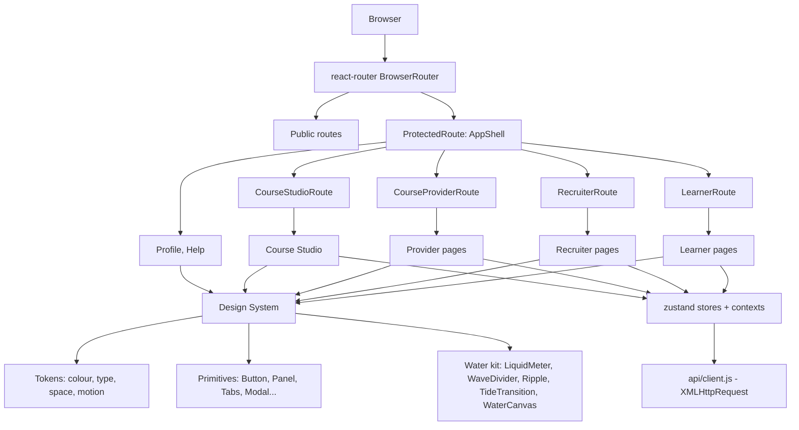
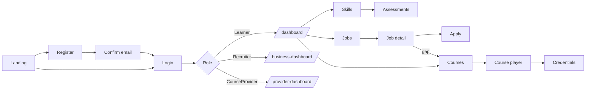

# Design Document: Frontend Design

## Overview

This document specifies the complete UX/UI design of the Cebu Upskilling web SPA (`frontend/`, React 19 + Vite +
react-router 7 + zustand). It does two things: (1) formalizes the current information architecture, page inventory and
component set, and (2) defines a new visual and motion direction, "Tide", with targeted UX improvements.

The product is a career-pathway platform for Cebu. Learners build a verified skill profile, find jobs, close skill gaps
through courses and take assessments. Recruiters post jobs, review applicants and author courses. Course providers
publish curriculum. There are exactly three authenticated roles (`Learner`, `Recruiter`, `CourseProvider`) plus
unauthenticated visitors. Everything below is scoped to those four audiences.

Scope: web only (responsive down to 360px). The Expo app is out of scope. Language: English only. The existing API
contract (`docs/API.md`) is unchanged. Routes, guards and data flow stay as they are unless a section says otherwise.

Direction in one sentence: a calm, tactile, water-themed interface (Cebu is an island city) with real content, real
data and purposeful motion, and none of the generic "AI template" look.

### Design Principles

1. **Real content only.** No lorem ipsum, no placeholder stats, no stock hero copy. Every empty state says what to do
   next. Numbers come from the API or are not shown.
2. **Motion explains state.** Water motion appears where it carries meaning (progress, match level, loading, success).
   Decoration is limited to one ambient surface per page, at most.
3. **One accent, used rarely.** Colour carries status, not decoration.
4. **Density follows task.** Dashboards and tables are compact. Reading and learning surfaces are spacious.
5. **Accessible first.** WCAG 2.1 AA, full keyboard use, `prefers-reduced-motion` honoured everywhere.

### Anti-Slop Rules (enforced in review)

| Avoid | Do instead |
|-------|-----------|
| Purple/blue gradient hero blobs, neon glows | Flat tonal surfaces; one subtle sea-light gradient on hero only |
| Glassmorphism cards everywhere | Opaque surfaces with 1px hairlines; blur only on overlays |
| Emoji as icons; mixed icon sets | `lucide-react` only, one stroke width (1.75) |
| Identical rounded cards in a 3-up grid | Varied layouts: table, split pane, timeline, ledger |
| "Unlock your potential" copy | Specific copy: "2 gaps left for Junior QA Analyst" |
| Gratuitous bounce/parallax | Easing `--ease-tide`, 120–320ms, transform/opacity only |
| Centered-everything layouts | Left-aligned text, asymmetric grid, strong baseline rhythm |

## Architecture



### Layering rules

- Pages compose shared components and never hold styling constants beyond layout. Inline `styles` objects in pages
  (the current pattern) migrate to CSS Modules plus tokens, page by page.
- The water kit sits in `components/water/` and depends only on tokens and `useMotionPreference`.
- `api/client.js` keeps using `XMLHttpRequest` (a browser extension patches `fetch`). Do not change this.

### Role-to-landing mapping (existing, unchanged)

| Role | Landing after login | Shell navigation |
|------|--------------------|------------------|
| Learner | `/dashboard` | "My pathway" + "Account" groups |
| Recruiter | `/business-dashboard` | "Employer tools" |
| CourseProvider | `/provider-dashboard` | "Provider studio" |

## Information Architecture and Page Inventory

Source of truth is `App.jsx`. "Target change" lists what this spec changes. "None" means visual restyle only.

### Public (no shell)

| Route | Page | Purpose | Target change |
|-------|------|---------|---------------|
| `/` | LandingPage | Explain value, route to register/login | Rebuild hero with water surface; real Cebu job and course counts from API where public, otherwise omit |
| `/login` | LoginPage | Email + password, Google sign-in | Inline field errors, 429 cooldown message |
| `/register` | RegisterPage | Learner (with resume PDF/DOCX) or company registration | Two-step flow with progress; resume parse preview |
| `/confirm-email` | ConfirmEmailPage | Token confirmation | Clear success/expired states, resend action |
| `/forgot-password` | ForgotPasswordPage | Request reset | None (always-200 copy kept neutral) |
| `/reset-password` | ResetPasswordPage | Set new password | Password strength meter |
| `/companies/:companyId` | CompanyProfilePage | Public company page + its posts | Restyle |
| `/privacy`, `/terms` | Legal pages | Policy text | Typographic reading template |
| `*` | NotFoundPage | 404 | Role-aware "go home" link |

Certificate verification by serial number (`GET /api/certificates/verify/{serialNumber}`) is public in the API but has
no page today. This spec adds `/verify/:serialNumber` (see Open Items).

### Learner (`LearnerRoute`)

| Route | Page | Purpose | Target change |
|-------|------|---------|---------------|
| `/dashboard` | OverviewPage | Target role, top skill gaps, weekly stats, pathway | Restructure into "Next move" + "This week" + "Pathway"; liquid match meter |
| `/skills` | SkillsPage | Skill profile, verified vs declared, resume parse | Verified skills visually distinct (solid vs outlined) |
| `/jobs` | JobsPage | Search/filter/sort jobs (paged) | Sticky filter bar, URL-synced filters, match % on each row |
| `/jobs/:postId` | JobDetailPage | Job detail, gaps, apply | Gap breakdown beside apply panel; idempotent apply feedback |
| `/courses` | CoursesPage | Enrolled + recommended, category filter | Continue-learning strip first |
| `/courses/:courseId/learn[/:lessonId]` | CourseContentPage | Player, outline, notes, discussion, resources | Three-pane desktop layout; progress saved visibly |
| `/applications` | ApplicationsPage | Own applications with status | Timeline status per application |
| `/assessments` | AssessmentsPage | Available, recommended, results; proctored attempt | Pre-flight camera check step; integrity states |
| `/credentials` | CredentialsPage | Issued certificates | Grid with verify link |
| `/credentials/:certificateId` | CertificateDetailPage | Certificate, serial, share/verify | Printable layout |

### Recruiter (`RecruiterRoute`)

| Route | Page | Purpose | Target change |
|-------|------|---------|---------------|
| `/business-dashboard` | BusinessDashboardPage | Company stats, demand, postings | Demand chart with real series only |
| `/post-job` | PostJobPage | Create post | Sectioned form with live preview |
| `/edit-job/:postId` | EditJobPage | Edit post | Reuse PostJob form |
| `/job-applications` | JobApplicationsPage | Review applicants, update status, AI ranking | Table with side detail pane |
| `/company-profile` | CompanyProfileEditPage | Edit company | Live public-profile preview |

### CourseProvider (`CourseProviderRoute`)

| Route | Page | Purpose | Target change |
|-------|------|---------|---------------|
| `/provider-dashboard` | ProviderDashboardPage | Course counts, last updated | Status-grouped course list |

### Shared by Recruiter and CourseProvider (`CourseStudioRoute`)

| Route | Page | Purpose | Target change |
|-------|------|---------|---------------|
| `/company-courses` | CourseManagementPage | List own courses | Draft/Published groups |
| `/company-courses/new` | CourseManagementPage | Create (manual or AI-generated draft) | Stepper: Basics, Outline, Lessons, Publish |
| `/company-courses/:courseId/edit` | CourseManagementPage | Edit; publish; delete (409 handled) | Autosave indicator; clear 409 message |

### Shared by all authenticated roles

| Route | Page | Target change |
|-------|------|---------------|
| `/profile` | ProfilePage | Sectioned settings, theme toggle |
| `/help` | HelpPage | Searchable FAQ |

## Navigation and Key Flows



### Flow: learner closes a skill gap

```mermaid
sequenceDiagram
    participant U as Learner
    participant JD as JobDetailPage
    participant C as CoursesPage
    participant P as CourseContentPage
    participant API as API
    U->>JD: Open job
    JD->>API: GET /posts/{id}, GET /skillgaps
    JD-->>U: Match % + gap list
    U->>C: "Close gap" on a skill
    C->>API: GET /coursespage?category
    U->>C: Enroll
    C->>API: POST /enrollments
    U->>P: Learn lesson
    P->>API: PUT /coursecontent/lessons/{id}/progress
    API-->>P: progress (+ certificate at 100% if enabled)
    P-->>U: Meter rises; certificate toast
```

### Shell behaviour

- Desktop (≥1024px): left rail 248px (existing) and a 70px topbar with breadcrumb label, notifications and theme.
- Tablet (640–1023px): rail collapses to icon-only 72px.
- Mobile (<640px): rail hidden, `MobileNav` bottom bar with at most 5 destinations; extra items go under "More".
- The skip-link and `main#main-content` focus target stay.

## Visual Design: "Tide"

### Colour tokens

Token names are kept (`--bg`, `--surface`, `--teal`, `--coral`, ...) so existing components keep working. Values change.
All text/background pairs must reach 4.5:1 and UI boundaries 3:1.

| Token | Light | Dark | Use |
|-------|-------|------|-----|
| `--bg` | `#f5f7f6` | `#06151c` | App background (sand-white / deep sea) |
| `--surface` | `#ffffff` | `#0c222c` | Panels |
| `--surface2` | `#eaefee` | `#133040` | Wells, table stripes |
| `--ink` | `#0a1d26` | `#e6f0f2` | Body text |
| `--muted` | `#4f6169` | `#8fa9b3` | Secondary text |
| `--line` | `#c5d0d2` | `#244250` | Hairlines |
| `--teal` | `#0b6e7f` | `#3fb6c4` | Primary (Visayan Sea) |
| `--teal-soft` | `#dff1f3` | `#103842` | Primary wash |
| `--coral` | `#c2410c` | `#f08a4b` | Single accent: calls to action that matter |
| `--good` / `--danger` / `--amber-ink` | existing hues, re-checked for AA | | Status |

### Typography

| Role | Face | Notes |
|------|------|-------|
| Display / headings | Bricolage Grotesque | Replaces Space Grotesk; tight tracking only ≥24px |
| Body / UI | Instrument Sans | 15px base, 1.55 line height |
| Numerics / eyebrows | JetBrains Mono | `font-variant-numeric: tabular-nums` |

Fonts are self-hosted (`@fontsource`), `font-display: swap`, Latin subset only. Scale: 12, 13, 15, 17, 20, 24, 32, 44.

### Spacing, shape, elevation

- 4px base grid. Radius: 8 (controls), 14 (panels), 22 (overlays).
- Elevation by hairline plus a single soft shadow for overlays. No stacked shadows.

## Motion Design: the Water Kit

Water appears in five places and nowhere else.

| Component | Where | Behaviour |
|-----------|-------|-----------|
| `LiquidMeter` | Skill match %, course progress, assessment score | Vertical or horizontal vessel; fill level animates with a gently moving wave edge; value is also printed as text |
| `WaveDivider` | Landing sections, dashboard hero base | Two-layer SVG wave, slow horizontal drift (CSS transform) |
| `Ripple` | Primary buttons, success confirmations | Radial ripple from the pointer origin, 450ms |
| `TideTransition` | Route changes | 220ms cross-fade with 6px vertical drift; no displacement filter on content pages |
| `WaterCanvas` | Landing hero and learner dashboard hero only | WebGL caustic light on a dark sea surface; pointer creates soft ripples |

### Motion rules

- Easing `--ease-tide: cubic-bezier(0.22, 1, 0.36, 1)`. Durations: micro 120ms, standard 220ms, large 320ms.
- Only `transform` and `opacity` animate in the main thread. No layout-property animation.
- At most one `WaterCanvas` on screen. It pauses when off-screen (`IntersectionObserver`) or the tab is hidden.
- `WaterCanvas` is progressive enhancement: skipped when `prefers-reduced-motion`, `Save-Data`, no WebGL2, or
  `hardwareConcurrency <= 2`. The fallback is a static SVG wave on the same gradient, so layout never shifts.
- Under `prefers-reduced-motion`, waves freeze, ripples become a 120ms opacity flash, and transitions are instant.
- Motion never carries the only signal: meters always show a number, errors always show text.

## Components and Interfaces

### Existing primitives (kept, restyled)

`Button`, `Panel`, `Tabs`, `Tag`, `Modal`, `ProgressBar`, `Skeleton`, `ErrorState`, `PasswordField`, `EmptyState`,
`StatCard`, `JobCard`, `CourseCard`, `AssessmentCard`, `SkillGapItem`, `TargetRoleCard`, `VideoPlayer`, `ModuleOutline`,
`LessonContent`, `LessonResources`, `DiscussionModal`, `CookieBanner`, `GoogleSignInButton`, `CompanyAvatar`, `BarList`.

`ProgressBar` becomes a thin wrapper that renders `LiquidMeter` in `variant="bar"`.

### New components

```jsx
/** components/water/LiquidMeter.jsx */
// props: value (0-100), label (string, required), variant: 'bar' | 'vessel' | 'ring', tone: 'primary' | 'good' | 'warn'
export function LiquidMeter({ value, label, variant = 'bar', tone = 'primary' }) { /* ... */ }

/** components/water/WaterCanvas.jsx */
// props: intensity (0-1), interactive (bool). Renders fallback when motion is disallowed.
export function WaterCanvas({ intensity = 0.5, interactive = true }) { /* ... */ }

/** components/water/Ripple.jsx */
export function useRipple(ref) { /* attaches pointerdown handler, returns cleanup */ }

/** components/water/WaveDivider.jsx */
export function WaveDivider({ flip = false, tone = 'surface' }) { /* ... */ }

/** hooks/useMotionPreference.js */
// returns { reduced: boolean, canUseWebGL: boolean, saveData: boolean, allowAmbient: boolean }
export function useMotionPreference() { /* ... */ }

/** components/ui/Field.jsx - label + control + hint + error, wired with aria-describedby */
export function Field({ id, label, hint, error, children }) { /* ... */ }

/** components/ui/DataTable.jsx - sortable, keyboard-navigable, responsive to stacked rows <640px */
export function DataTable({ columns, rows, getRowId, onRowSelect, caption }) { /* ... */ }

/** components/ui/Stepper.jsx - used by Register and Course Studio */
export function Stepper({ steps, current, onSelect }) { /* ... */ }

/** components/ui/Toast viewport: aria-live=polite, 5s, pause on hover/focus */
```

### Route guards (existing contract, restated)

```jsx
export function LearnerRoute() {
  const { user } = useAuth();
  if (isRecruiter(user) || isCourseProvider(user)) return <Navigate to={getDashboardPath(user)} replace />;
  return <Outlet />;
}
// RecruiterRoute, CourseProviderRoute and CourseStudioRoute follow the same shape:
// a user outside the allowed role set is redirected to their own dashboard, never to a blank or error page.
```

## Data Models

UI view-models.

```jsx
// Derived on the client from API responses. Not persisted.
const SkillMeterVM = { skillId, name, requiredLevel, currentLevel, verified, matchPct };
const JobRowVM = { postId, title, company, location, jobType, isRemote, matchPct, appliedState };
const CourseCardVM = { courseId, title, category, progressPct, enrolled, issuesCertificate };
const ApplicationVM = { postId, title, company, status, updatedAt };
```

Validation rules: `matchPct` and `progressPct` are integers clamped to 0–100. Missing values render as "—", never as 0.

## Algorithmic Pseudocode

### Liquid meter level

```pascal
ALGORITHM computeMeterLevel(value, reduced)
INPUT: value (number or undefined), reduced (boolean)
OUTPUT: { level, waveAmplitude, label }

BEGIN
  IF value IS undefined OR value IS NaN THEN
    RETURN { level: 0, waveAmplitude: 0, label: "—" }
  END IF

  level ← ROUND(CLAMP(value, 0, 100))

  IF reduced = true OR level = 0 OR level = 100 THEN
    amplitude ← 0
  ELSE
    amplitude ← MIN(4, level / 10)
  END IF

  RETURN { level, waveAmplitude: amplitude, label: level + "%" }
END
```

**Preconditions:** none (input may be absent).
**Postconditions:** `0 <= level <= 100`; `label` is always text; `waveAmplitude = 0` when `reduced`.
**Loop invariants:** N/A.

### Ambient water gating

```pascal
ALGORITHM shouldRenderWaterCanvas(env, activeCanvasCount)
INPUT: env { reduced, saveData, webgl2, cores, inView, tabVisible }, activeCanvasCount
OUTPUT: mode in { "animate", "paused", "static" }

BEGIN
  IF env.reduced OR env.saveData OR NOT env.webgl2 OR env.cores <= 2 THEN
    RETURN "static"
  END IF
  IF activeCanvasCount >= 1 THEN
    RETURN "static"
  END IF
  IF NOT env.inView OR NOT env.tabVisible THEN
    RETURN "paused"
  END IF
  RETURN "animate"
END
```

**Postconditions:** at most one canvas is ever in `"animate"`; `"static"` always shows the SVG fallback with identical
dimensions.

### Role-aware navigation

```pascal
ALGORITHM navItemsFor(user)
INPUT: user (may be null)
OUTPUT: list of nav groups

BEGIN
  IF user IS NULL THEN RETURN [] END IF
  CASE normalize(user.role) OF
    "courseprovider": RETURN [providerNav]
    "recruiter":      RETURN [recruiterNav]
    OTHERWISE:        RETURN [learnerPathwayNav, learnerAccountNav]
  END CASE
END
```

**Postconditions:** every returned `to` path is reachable under that role's guard. No item links to a route the role
would be redirected away from.

## Page Wireframes (key pages)

### Learner dashboard (`/dashboard`)

```
┌ Rail ┬──────────────────────────────────────────────────────────┐
│      │ Topbar                                                   │
│      ├──────────────────────────────┬───────────────────────────┤
│      │ NEXT MOVE (hero, WaterCanvas)│ THIS WEEK                 │
│      │ "2 gaps left for <role>"     │ hours · lessons · streak  │
│      │ [Continue: <lesson>]         ├───────────────────────────┤
│      ├──────────────────────────────┤ OPEN APPLICATIONS         │
│      │ PATHWAY (ordered courses,    │ timeline, 3 most recent   │
│      │ LiquidMeter per skill)       │                           │
└──────┴──────────────────────────────┴───────────────────────────┘
```

### Course player (`/courses/:id/learn/:lessonId`)

```
┌ Outline (collapsible) ┬ Lesson (video/doc/text) ┬ Notes | Discussion ┐
│ modules, lesson state │ title, content          │ tabs, autosave     │
│ LiquidMeter overall   │ [Prev]  [Mark complete] │                    │
└───────────────────────┴─────────────────────────┴────────────────────┘
```
Below 1024px the right pane becomes a bottom sheet; below 640px the outline becomes a drawer.

### Employer applicants (`/job-applications`)

```
┌ Filters: post · status · search ───────────────────────────────┐
│ DataTable (candidate, match, applied, status)  │ Detail pane   │
│                                                │ skills, AI    │
│                                                │ rank, actions │
└────────────────────────────────────────────────┴───────────────┘
```

## Cross-Cutting UX Behaviour

### State patterns (every data-bound view)

| State | Treatment |
|-------|-----------|
| Loading | `Skeleton` matching final layout, no spinner-only screens, no layout shift |
| Empty | `EmptyState` with one primary action |
| Error | `ErrorState` with message from `{ error }` and a Retry button |
| Success | Toast (non-blocking) plus inline change; destructive actions use `Modal` confirm |

### Forms

- Labels always visible; errors inline under the field and summarised at the top for forms longer than 5 fields.
- Server validation (400 `{ error }`) maps to the form summary. 429 shows "Too many attempts, try again in a minute".
- Unsaved changes prompt before route leave on Post Job, Company Profile and Course Studio.

### Accessibility

- WCAG 2.1 AA. Visible 2px focus ring (`--teal`, 3:1 against adjacent colours).
- Modals trap focus and restore it on close; Tabs follow the ARIA tabs pattern with arrow keys.
- Proctored assessment: camera permission explained before the prompt; every integrity warning has text and sound-free
  visual treatment.
- Touch targets ≥ 44px on mobile.

### Performance budgets

| Metric | Target |
|--------|--------|
| LCP (landing, 4G) | ≤ 2.5s |
| CLS | ≤ 0.05 |
| INP | ≤ 200ms |
| Initial JS (gzip, landing) | ≤ 180 KB |
| Route chunks | One lazy chunk per page; `mediapipe`, `pdfjs`, `mammoth` loaded only on assessment, resume upload and document pages |
| Water kit | WebGL shader code in its own chunk, loaded after first paint |

## Correctness Properties

*A property is a characteristic or behavior that should hold true across all valid executions of a system-essentially,
a formal statement about what the system should do. Properties serve as the bridge between human-readable
specifications and machine-verifiable correctness guarantees.*

### Property 1: Role isolation

For any role R and any route P guarded for a different role, navigating to P as R ends at R's own dashboard path and
no page content for P renders.

**Validates: Requirements 1.2, 1.3**

### Property 2: Nav reachability

For any user role string (including null and unknown values), every item returned by `navItemsFor` resolves to a route
that role's guard allows, and a null user yields no items.

**Validates: Requirements 2.1, 2.2, 2.3, 2.4, 2.5, 2.6, 2.7**

### Property 3: Meter bounds and label

For any numeric input, `computeMeterLevel` returns `0 <= level <= 100`, the label equals the rounded level followed by
"%", and for undefined, null or NaN input it returns level 0 with the label "—".

**Validates: Requirements 15.1, 15.2, 15.3, 15.11**

### Property 4: Meter wave amplitude

For any value and any `reduced` flag, `waveAmplitude` is 0 when `reduced` is true or the level is 0 or 100, and
otherwise equals `min(4, level / 10)`.

**Validates: Requirements 15.4, 15.5, 15.6**

### Property 5: Reduced motion

For any component and animation in the app, when `prefers-reduced-motion: reduce` is set, no CSS animation lasts more
than 10ms, no `WaterCanvas` is animating, and every `LiquidMeter` has `waveAmplitude = 0`.

**Validates: Requirements 15.4, 16.1, 17.1, 17.2, 17.3, 17.4**

### Property 6: Canvas gating and single ambient canvas

For any environment and active canvas count, `shouldRenderWaterCanvas` returns `"static"` when reduced motion,
Save-Data, missing WebGL2 or `cores <= 2` holds, returns `"static"` when `activeCanvasCount >= 1`, and never returns
`"animate"` in those cases; at no time is more than one canvas in `"animate"` mode.

**Validates: Requirements 16.1, 16.2, 16.3, 16.4, 16.5**

### Property 7: No colour-only signals

For any status value (application, assessment, lesson, integrity), the rendered status element contains text or an icon
with an accessible name in addition to colour.

**Validates: Requirements 21.8**

### Property 8: Contrast

For any token text/background pair used in either theme, the contrast ratio is at least 4.5:1 (3:1 for large text and
UI borders).

**Validates: Requirements 14.2**

### Property 9: Idempotent actions

For any job or course, applying or enrolling a second time shows the "already applied" or "already enrolled" state and
never an error toast.

**Validates: Requirements 7.9, 8.3**

### Property 10: Page states complete

For any data-bound page, the page implements loading, empty and error states.

**Validates: Requirements 18.1, 18.2, 18.3, 18.9**

### Property 11: Table sort order

For any set of rows and any sortable column, activating that column's header yields rows ordered by that column's
values and preserves the multiset of rows.

**Validates: Requirements 20.1**

## Error Handling

| Scenario | Condition | Response | Recovery |
|----------|-----------|----------|----------|
| Session expired | 401 on any call | Attempt refresh once; on failure sign out | Redirect `/login` with return path |
| Wrong role | 403 or guard mismatch | Redirect to own dashboard | None needed |
| Not found / hidden resource | 404 | `NotFoundPage` or inline "not available" | Link to list page |
| Rate limited | 429 | Inline message with wait hint | Disable submit for 10s |
| Upload too large | 413 | Field error naming the limit (video 500MB, docs 10MB) | Re-pick file |
| Course delete blocked | 409 | Modal explaining learners are enrolled | Offer "Unpublish" guidance |
| AI upstream failure | 502/503 | "Suggestions are unavailable right now" | Manual path remains usable |
| Camera denied (assessment) | `NotAllowedError` | Explain why camera is needed, link to browser help | Retry or leave |
| Network offline | XHR error | Banner "You're offline" | Auto-retry on reconnect |
| WebGL failure | Context creation fails | Static SVG fallback | Silent |

## Testing Strategy

### Unit testing

Vitest + Testing Library (existing, 70 files). Every new component gets tests for props, a11y roles and reduced-motion
behaviour. Pure functions (`computeMeterLevel`, `shouldRenderWaterCanvas`, `navItemsFor`) get table tests.

### Property-based testing

Library: `fast-check`.

- `computeMeterLevel`: for any number/NaN/undefined, output is within bounds and label matches level (Property 3).
- `shouldRenderWaterCanvas`: for any env and count, result is `"static"` when reduced, and never `"animate"` when
  `activeCanvasCount >= 1` (Properties 4, 5).
- `navItemsFor`: for any role string, every returned path passes that role's guard (Properties 1, 2).

### End-to-end

Playwright (existing, chromium) per role: login → land on correct dashboard → visit each nav item → no console errors.
Add `@axe-core/playwright` scans on every page in both themes, and a run with `reducedMotion: 'reduce'`.

### Visual regression

Playwright screenshots for the top 10 pages at 360, 768, 1280px in both themes. `WaterCanvas` is replaced with its
static fallback for deterministic snapshots.

## Migration Plan

1. Tokens, fonts and `useMotionPreference` (no visible layout change).
2. Primitives restyle (`Button`, `Panel`, `Tabs`, `Tag`, `Modal`, `ProgressBar` → `LiquidMeter`).
3. Shell: rail, topbar, mobile nav, `TideTransition`.
4. Public pages: Landing (with `WaterCanvas`), auth pages.
5. Learner pages, then Recruiter, then Provider and Course Studio.
6. Remove inline style objects as each page moves to CSS Modules; delete unused tokens.

Each step ships behind green `npm test`, `npm run lint`, `npm run build` and the Playwright suite.

## Security Considerations

- Rendered user/AI markdown continues through `marked` + `DOMPurify`.
- No tokens in URLs or logs; analytics (PostHog) only after cookie consent.
- Shader and font assets are self-hosted to stay within the backend CSP (`default-src 'self'`).

## Dependencies

Existing: react, react-router-dom, zustand, lucide-react, marked, dompurify, pdfjs-dist, mammoth,
@mediapipe/tasks-vision, @sentry/react, posthog-js.

New (pinned exact versions when added): `@fontsource/bricolage-grotesque`, `@fontsource/instrument-sans`,
`@fontsource/jetbrains-mono`, `fast-check` (dev), `@axe-core/playwright` (dev). The shader is hand-written GLSL with no
3D library, to keep the chunk small.

## Open Items

- Certificate verification page `/verify/:serialNumber` is proposed because the public endpoint already exists.
- Final brand name/logo mark: the "CU" square is kept until a logo is supplied.
- Real public counts on the landing page require an unauthenticated stats source; if none exists, the section is omitted.
